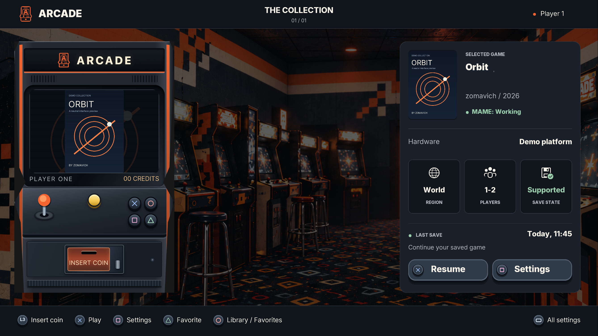
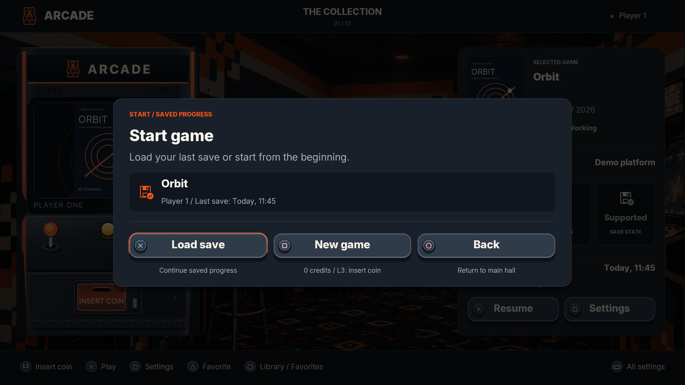
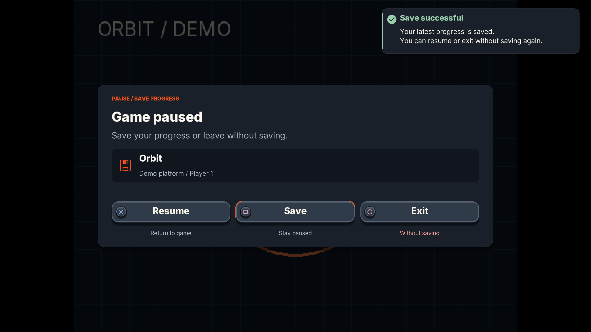

# Arcade

**Your arcade library, built for the big screen.**

A native PS5 arcade emulator by **zomavich**, with a controller-first library, per-game save states, and automatic screen orientation.

[Download v0.2.1](https://github.com/zomavich-netizen/Arcade-PS5/releases/tag/v0.2.1) · [Report an issue](https://github.com/zomavich-netizen/Arcade-PS5/issues)



*Captured from the native host preview using fictional demonstration entries. No games are bundled.*

## Features

- Browse your collection, mark favorites, and open per-game settings.
- See manufacturer, year, hardware, region, player count, compatibility, and save-state support.
- Save progress separately for each game and profile.
- Choose **Load save** or **New game** when starting a game with saved progress.
- Use separate **Resume**, **Save**, and **Exit** controls. Saving keeps the game paused; exiting does not save automatically.
- Read save results in a notification that disappears automatically.
- Apply the engine's correct screen orientation automatically, with a manual adjustment available.
- Adjust video, audio, controller, accessibility, profile, and diagnostic settings.
- Control menu music, volume, mute, and reduced motion. Menu music stops during gameplay.

## Install or update

1. Download `Arcade-v0.2.1-PS5.zip` and `SHA256SUMS` from the release page.
2. Close Arcade before updating.
3. Extract the complete `PPSA99984` folder to `/data/homebrew/` using your existing PS5 homebrew setup.
4. Launch Arcade from the PS5 home screen.

Keep your existing game files, settings, covers, and saves. The default content locations are `/data/arcade/roms` and `/data/arcade/bios`; user data is kept outside the replaceable app package.

A compatible PS5 homebrew environment is required. Development testing used firmware 11.40; other setups need their own compatibility checks. ProsperoStore installation will be available after the catalog submission is approved.

## Start a game

Load your last save or begin a new session. Starting fresh uses the game's usual credit and Start controls; loading a save does not require an extra credit.



## Save and exit

Save while paused, resume playing, or return to the main hall without saving. A failed save preserves the previous successful save.



## Default controls

| Where | Control | Action |
| --- | --- | --- |
| Library | D-pad | Browse |
| Library | Cross | Play or open saved-game choices |
| Library | Square | Per-game settings |
| Library | Triangle | Toggle favorite |
| Library | Circle | Library / Favorites |
| Library | Touchpad | All settings |
| Library or gameplay | L3 | Insert credit |
| Gameplay | Options / R3 | Start |
| Gameplay | Touchpad | Pause menu |

Confirm and Back follow your configured button preference.

## Compatibility and support

This is a development prerelease. OpenGL is the default renderer; Vulkan is experimental and is not console-qualified. A compiled driver does not guarantee that a game works. Read the compatibility status and error code shown by the app.

When reporting a problem, include the release version, error code, and reproduction steps. Do not attach games, BIOS files, credentials, or private console information.

## Build from source

The host preview requires CMake, a C++17 compiler, and the macOS Command Line Tools:

```sh
cmake -S . -B build
cmake --build build -j4
ctest --test-dir build --output-on-failure
```

PS5 builds use the pinned MAME source, Payload SDK v0.42, and ps5-opengl SDK 1.0.2, with optional Mesa/RADV support. Build scripts and dependency information are included in `tools/` and [third-party notices](THIRD-PARTY.md). Dependencies and build products are not committed.

The staged native application is `build/title/PPSA99984`. Its source metadata lives at `ps5/sce_sys/param.json`. Console content version is `01.000.001` and must increase with each release.

## Responsible use and license

Arcade is **not a piracy project**. It does not provide games, ROMs, or BIOS files. Obtain and use only content you are entitled to use. You are responsible for how you use the application and your content.

Arcade is GPL-3.0-or-later. Third-party components retain their own licenses and credits; see [LICENSE](LICENSE) and [THIRD-PARTY.md](THIRD-PARTY.md).
